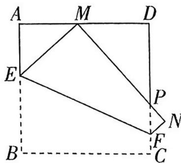

<!-- question-source:start -->
1 [2024 江苏连云港调研, 中]如图, 将边长为 $12 \mathrm{~cm}$ 的正方形纸片 ABCD 沿 EF 折叠 (点 E, F 分别在边 AB, CD 上), 使点 B 落在 AD 边上的点 M 处, 点 C 落在点 N 处, MN 与 CD 交于点 P. 若 $AM = 5 \mathrm{~cm}$ , 则折痕 EF 的长为 \_\_\_\_ cm.

<!-- question-source:end -->

![[Q00107767A1]]
