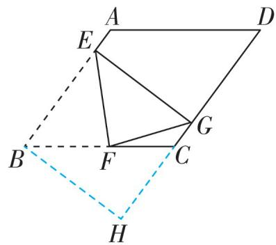

> [!success]- 必刷题
>
> > [!success] **【答案】** $\frac{9}{14}$
>
> > [!note]- **【解析】**
> > 如图, 作 $BH \perp CD$ 交 $DC$ 的延长线于点 $H$ , 则 $\angle H = 90^{\circ}$ . $\because EG \perp CD, \therefore BH \parallel$
> >
> > EG. ∵ 四边形 ABCD 是菱形, ∴ $AB \parallel CD$ , AB = BC = CD, ∴ $BE \parallel GH$ ,
> > ∴ 四边形 BEGH 是平行四边形, ∴ BH = GE,
> > GH = BE = 4. 由翻折得
> >
> > 
> >
> > 方法总结翻折问题常利用图形本身的性质、全等三角形、勾股定理、方程思想等知识求解.
> >
> > $GE = BE = 4, \therefore BH = GE = 4. \because DG = 3, \therefore DH =$ $DG + GH = 3 + 4 = 7. \because BH^2 + CH^2 = BC^2, CH = 7-$ $CD = 7 - AB, \therefore 4^2 + (7 - AB)^2 = AB^2$ , 解得 $AB =$ $\frac{65}{14}, \therefore AE = AB - BE = \frac{65}{14} - 4 = \frac{9}{14}$ , 故答案为 $\frac{9}{14}$ .
