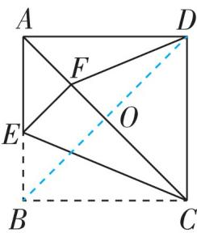

> [!success]- 必刷题
>
> > [!success] **【答案】** $3\sqrt{2} +4
>
> > [!note]- **【解析】**
> > 如图, 连接 BD 交 AC 于 O.
> > ∵ 四边形 ABCD 为正方形, ∴ $\angle ABC = 90^{\circ}$ ,
> >
> > $AB = BC, AC \perp BD, DO = BO,$ $\therefore \angle BAC = 45^{\circ}.\because \triangle BCE$ 沿 $CE$ 翻折， $\therefore BE = EF = 2,BC =$ $CF,\angle EFC = \angle ABC = 90^{\circ},$ $\therefore \angle AEF = 45^{\circ},\therefore AF = EF = 2,$
> >
> > 
> >
> > $\therefore AE = 2\sqrt{2}, \therefore AB = 2\sqrt{2} + 2 = BC = CF = CD,$ $\therefore BD = 4 + 2\sqrt{2}, \therefore OD = 2 + \sqrt{2}, \therefore S_{\triangle CDF} = \frac{1}{2}\times$ $CF\times DO = 3\sqrt{2} +4.$ 故答案为 $3\sqrt{2} +4.$
