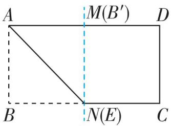
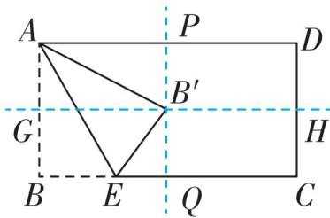

> [!success]- 必刷题
>
> > [!success] **【答案】** C
>
> > [!note]- **【解析】**
> > 分两种情况: ①如图(1)所示, 当 $B'$ 恰好在矩形的对称轴 $MN$ 上时, 易知点 $B'$ 与点 $M$ 重合, 点 $E$ 与点 $N$ 重合. $\because AB = 4$ , $BE = \frac{1}{2} BC = 4$ , $\therefore AE = \sqrt{AB^{2} + BE^{2}} = \sqrt{4^{2} + 4^{2}} = 4\sqrt{2}$ .
> >
> > 
> >
> > 
> > 图(1)
> > 图(2)
> > - **②**：如图(2)所示,当 $B'$ 恰好在矩形的对称轴 $GH$ 上时,过 $B'$ 作 $PQ \parallel AB$ 交 $AD$ 于 $P$ ,交 $BC$ 于 $Q$ , $\therefore PQ \perp AD, PQ \perp BC, PB' = QB' = \frac{1}{2} PQ = \frac{1}{2} AB = 2, AP = BQ$ . $\because$ 四边形 $ABCD$ 是矩形, $\therefore \angle B = 90^\circ$ . 由折叠的性质得 $AB' = AB = 4$ , $BE = B'E$ . 在 Rt $\triangle APB'$ 中, $AP = \sqrt{AB'^2 - PB'^2} = \sqrt{4^2 - 2^2} = 2\sqrt{3}$ , $\therefore BQ = AP = 2\sqrt{3}$ . 设 $BE = B'E = x$ , 则 $EQ = BQ - BE = 2\sqrt{3} - x$ . 在 Rt $\triangle EB'Q$ 中, $EQ^2 + B'Q^2 = B'E^2$ , $\therefore (2\sqrt{3} - x)^2 + 2^2 = x^2$ , 解得 $x = \frac{4\sqrt{3}}{3}$ , 即 $BE = \frac{4\sqrt{3}}{3}$ , $\therefore AE = \sqrt{AB^2 + BE^2} = \sqrt{4^2 + \left(\frac{4\sqrt{3}}{3}\right)^2} = \frac{8\sqrt{3}}{3}$ . 综上所述, 当点 $B'$ 恰好在矩形的对称轴上时, 折痕 $AE$ 的长是 $4\sqrt{2}$ 或 $\frac{8\sqrt{3}}{3}$ ,
> >
> > 故选 **C**.
