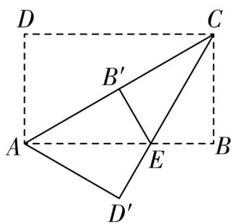
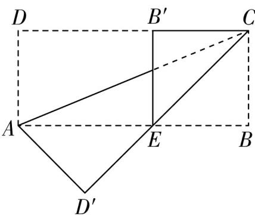

> [!success]- 必刷题
>
> > [!success] **【答案】** $2\sqrt{3}$ 或 $2 + 2\sqrt{2}$
>
> > [!note]- **【解析】**
> > ∵ 四边形 $ABCD$ 为矩形, $\therefore BC = AD = 2$ , $\angle B = \angle D = 90^{\circ}$ . ∵ $\triangle ADC$ 沿对角线 $AC$ 翻折得到 $\triangle AD' C$ , $\therefore \angle D' = \angle D = 90^{\circ}$ , $AD' = AD = 2$ . ∵ 将 $\triangle BCE$ 沿 $CE$ 翻初中必刷题 数学九年级上册 BS
> > 折得到 $\triangle B^{\prime}CE, \therefore \angle CB^{\prime}E = \angle B = 90^{\circ}, CB^{\prime} = CB = 2.$ ①当点 $B'$ 恰好落在 AC 上时，如图(1). 在 $\triangle AD'E$ 和 $\triangle CBE$ 中， $\left\{\begin{aligned}\angle AED' &= \angle CEB, \\ \angle D' &= \angle B, \\ AD' &= CB,\end{aligned}\right.$ ∴ $\triangle AD^{\prime}E \cong \triangle CBE(AAS), \therefore EA = EC$ ，即 $\triangle EAC$ 为等腰三角形. ∵ $\angle CB^{\prime}E = 90^{\circ}, \therefore$ 点 $B'$ 为 AC 中点, $\therefore AC = 2CB' = 4.$ 在 Rt $\triangle ABC$ 中, $AB^{2} + BC^{2} = AC^{2}$ , 即 $AB^{2} + 2^{2} = 4^{2}$ , 解得 AB = $2\sqrt{3}$ (负值已舍去).
> >
> > 技巧点拨
> > 特殊平行四边形折叠问题的关键解题步骤:(1)由折叠确定等角及等长线段;(2)设未知数,利用勾股定理建立方程.
> >
> > 
> > 图(1)
> >
> > 
> > 图(2)
> > - **②**：当点 $B'$ 恰好落在 $DC$ 上时, 如图 (2). $\because \angle CB'E = \angle B = \angle DCB = 90^\circ$ , $\therefore$ 四边形 $B'EBC$ 为矩形, $\therefore B'E = CB = 2$ . $\because \triangle BCE$ 沿 $CE$ 翻折得到 $\triangle B'CE$ , $\therefore BE = B'E = 2$ , $\therefore$ 在 Rt $\triangle CBE$ 中, $CE = \sqrt{CB^2 + BE^2} = \sqrt{2^2 + 2^2} = 2\sqrt{2}$ . 同①可得 $\triangle AD'E \cong \triangle CBE$ , $\therefore AE = CE = 2\sqrt{2}$ , $\therefore AB = AE + BE = 2\sqrt{2} + 2$ . 故答案为 $2\sqrt{3}$ 或 $2 + 2\sqrt{2}$ .
