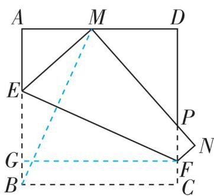

> [!success]- 必刷题
>
> > [!success] **【答案】** 13
>
> > [!note]- **【解析】**
> > 如图, 过点 $F$ 作 $FG \perp AB$ , 垂足为 $G$ , 连接 $BM$ . $\because$ 四边形 $ABCD$ 是正方形, $\therefore AB = BC$ . 易知四边形 $BCFG$ 是矩形, $\therefore FG = BC, \therefore AB = FG.$ ∵ 由折叠易知 $BM \perp FE, \therefore \angle EBM + \angle BEF = 90^{\circ}.$ ∵ $\angle BMA + \angle EBM = 90^{\circ}, \therefore \angle BEF = \angle BMA.$ 又∵ $\angle A = \angle EGF = 90^{\circ}, \therefore \triangle ABM \cong \triangle GFE, \therefore EF = BM = \sqrt{AB^{2} + AM^{2}} = \sqrt{12^{2} + 5^{2}} = 13 (\mathrm{~cm})$ . 故答案为 13.
> >
> > 
