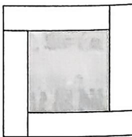

<!-- question-source:start -->
2 [中]《周髀算经》中有一种几何方法可以用来求形如 $x(x+6)=16$ 的方程的正数解, 方法: 如图, 将四个长为 $x+6$ , 宽为 x 的长方形纸片 (面积为 16) 拼成一个大正方形, 于是大正方形的面积为 $16 \times 4 + 36 = 100$ , 边长为 10, 故得 $x(x+6) = 16$ 的正数解为 $x = \frac{10 - 6}{2} = 2$ . 小明用此方法解关于 x 的方程 $x^{2} + mx - n = 0$ 时, 构造出同样的图形, 已知大正方形的面积为 14, 小正方形的面积为 4, 则 ( )

A. $m = 2, n = 3$ B. $m = \frac{\sqrt{14}}{2}, n = 2$ C. $m = \frac{5}{2}, n = 2$ D. $m = 2, n = \frac{5}{2}$

<!-- question-source:end -->

![[Q00107810A1]]
