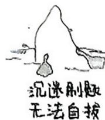

<!-- question-source:start -->
5 核心素养运算能力 [较难] 阅读下面的例题, 解决问题.
例: 解方程 $x^{2}-|x|-2=0$ .
解: ① 当 $x \geqslant 0$ 时, 原方程化为 $x^{2}-x-2=0$ , 解得 x=2 或 x=-1 (不合题意, 舍去);
②当x<0时,原方程化为 $x^{2}+x-2=0$ ,解得x=-2或x=1(不合题意,舍去).
∴ 原方程的根是 $x_{1}=2, x_{2}=-2$ .
请参照例题解方程: $x^{2}-|x-1|-1=0$ .

电子错题本鸭
<!-- question-source:end -->

![[Q00107813A1]]
