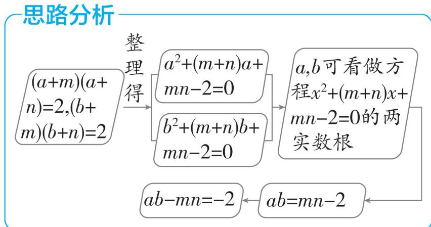

> [!success]- 必刷题
>
> > [!success] **【答案】** -2
>
> > [!note]- **【解析】**
> > 
> > 【解析】∵ $(a+m)(a+n)=2$ , $(b+m)(b+n)=2$ ,
> > ∴ $a^{2}+(m+n)a+mn-2=0, b^{2}+(m+n)b+mn-2=0.$ ∵ a, b, m, n 为互不相等的实数，∴ a, b 可看做方程 $x^{2}+(m+n)x+mn-2=0$ 的两实数根，
> > ∴ ab = mn - 2, ∴ ab - mn = -2. 故答案为 -2.
> >
> > ## 刷易错·
