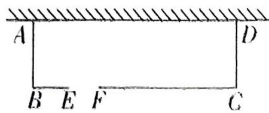
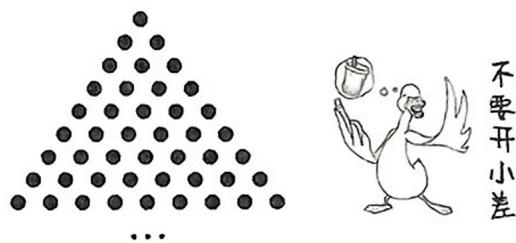

<!-- question-source:start -->
10[2023 山东东营中考]如图,老李想用长为 $70 \mathrm{~m}$ 的栅栏,再借助房屋的外墙(外墙足够长)围成一个矩形羊圈ABCD,并在边BC上留一个 $2 \mathrm{~m}$ 宽的门(建在EF处,另用其他材料). (1)当羊圈的长和宽分别为多少米时,能围成一个面积为 $640 \mathrm{~m}^{2}$ 的羊圈? (2)羊圈的面积能达到 $650 \mathrm{~m}^{2}$ 吗? 如果能,请你给出设计方案;如果不能,请说明理由.

<!-- question-source:end -->

![[Q00107861A1]]
