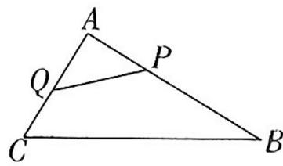

<!-- question-source:start -->
17 如图, 在 $\triangle ABC$ 中, $\angle A = 90^{\circ}, AB = 12 \mathrm{~cm}$ , $AC = 8 \mathrm{~cm}$ , 现有动点 $P$ 从点 $B$ 出发, 沿射线 $BA$ 方向运动, 动点 $Q$ 从点 $C$ 出发, 沿射线 $CA$ 方向运动, 已知点 $P$ 的速度是 $2 \mathrm{~cm} / \mathrm{s}$ , 点 $Q$ 的速度是 $1 \mathrm{~cm} / \mathrm{s}$ , 它们同时出发, 设运动时间是 $t \mathrm{~s}(t > 0)$ . (1) 当 $t = 4$ 时, 求 $\triangle APQ$ 的面积. (2) 经过多少秒, $\triangle APQ$ 的面积是 $\triangle ABC$ 面积的一半?

电子错题本鸭
<!-- question-source:end -->

![[Q00107878A1]]
