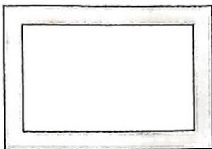

<!-- question-source:start -->
3 [2024 广东珠海期中]如图,在一幅长 80 cm,宽 50 cm 的矩形风景画的四周镶上宽度相等的金

色纸边,制成一幅矩形挂图,如果要使整个挂图的面积是 $5\ 000\ cm^{2}$ ,设金色纸边的宽为x cm,那么满足的方程是

( )

A. $x^{2} + 130x - 1400 = 0$ B. $x^{2} - 130x - 1400 = 0$ C. $x^{2} + 65x - 250 = 0$ D. $x^{2} - 65x - 250 = 0$
<!-- question-source:end -->

![[Q00108268A1]]
