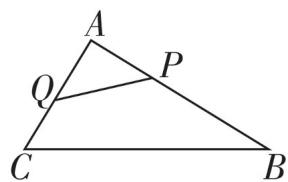
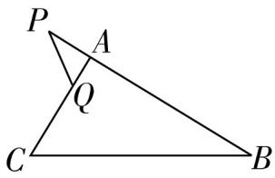
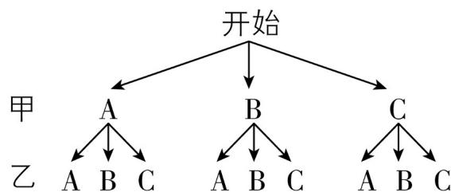
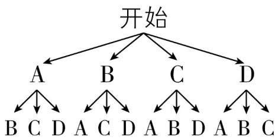
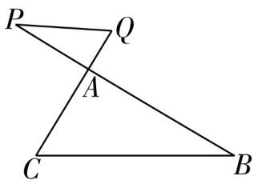

> [!success]- 必刷题
>
> > [!success] **【答案】** A
>
> > [!note]- **【解析】**
> > 【解】(1)∵点P的速度是2 cm/s, 点Q的速度是1 cm/s, ∴当t=4时, BP=2t=8 cm, CQ=t=4 cm, ∴AP=4 cm, AQ=4 cm. 又
> > ∵∠A=90°, ∴S $_{△APQ}$ = $\frac{1}{2}$ ×4×4=8(cm $^{2}$ ).
> > (2)根据题意得 $\frac{1}{2}$ S $_{△ABC}$ = $\frac{1}{2}$ × $\frac{1}{2}$ ×12×8=24(cm $^{2}$ ). 当0<t<6时, 如图(1), S $_{△APQ}$ = $\frac{1}{2}$ (12-2t)(8-t)=24, 整理得t $^{2}$ -14t+24=0, 解得t=12(舍去)或t=2.
> >
> > 
> > 图(1)
> >
> > 
> > 图(2)
> >
> > 当 6<t<8 时, 如图(2), $S_{\triangle APQ}=\frac{1}{2}(2t-12)\cdot(8-t)=24$ , 整理得 $t^{2}-14t+72=0$ , 无实数解.
> > 当 t>8 时, 如图(3), $S_{\triangle APQ}=\frac{1}{2}(2t-12)(t-8)=24$ , 整理得 $t^{2}-14t+24=0$ , 解得 t=12 或 t=2 (舍去).
> >
> > 综上所述,经过 2 s 或 12 s, $\triangle APQ$ 的面积是 $\triangle ABC$ 面积的一半.
> >
> > 
> > 图(3)
> >
> > ## 第三章 概率的进一步认识
> >
> > ## 1 用树状图或表格求概率
> >
> > ## 课时 1 用树状图或表格求概率
> >
> > ## 刷基础
> >
> > 1. A 【解析】将“做社区志愿者”和“做交通引导员”分别记为 A, B, 列表如下:
> >
> > <table><tr><td>乙\甲</td><td>A</td><td>B</td></tr><tr><td>A</td><td>(A,A)</td><td>(A,B)</td></tr><tr><td>B</td><td>(B,A)</td><td>(B,B)</td></tr></table>
> >
> > 刷有所得列表法适合分两步完成的事件的情况统计,注意不要漏情况.
> >
> > 共有 4 种等可能的结果, 其中两人同时选择 A 的结果有 1 种, ∴ 两人同时选择“做社区志愿者”的概率是 $\frac{1}{4}$ . 故选 A.
> >
> > 2. C 【解析】列表如下：
> >
> > <table><tr><td>袜子 鞋子</td><td>灰</td><td>白</td><td>蓝</td></tr><tr><td>灰</td><td>(灰,灰)</td><td>(灰,白)</td><td>(灰,蓝)</td></tr><tr><td>黑</td><td>(黑,灰)</td><td>(黑,白)</td><td>(黑,蓝)</td></tr></table>
> >
> > 共有 6 种等可能的结果, 其中他随机穿上一双袜子和鞋子, 恰好都为灰色的结果有 1 种, ∴ 他随机穿上一双袜子和鞋子, 恰好都为灰色的概率为 $\frac{1}{6}$ . 故选 C.
> >
> > 刷有所得通常情况下，列表法和画树状图法列出的都是一些等可能情况.
> >
> > 3. $\frac{2}{9}$ 【解析】将《西游记》《骆驼祥子》《水浒传》《朝花夕拾》分别记为 A, B, C, D, 列表如下:
> >
> > <table><tr><td>小颖 小明</td><td>A</td><td>B</td><td>D</td></tr><tr><td>A</td><td>(A,A)</td><td>(A,B)</td><td>(A,D)</td></tr><tr><td>B</td><td>(B,A)</td><td>(B,B)</td><td>(B,D)</td></tr><tr><td>C</td><td>(C,A)</td><td>(C,B)</td><td>(C,D)</td></tr></table>
> >
> > 共有9种等可能的结果,其中小明和小颖恰好选中书名相同的书的结果有2种,∴小明∵ 共有 12 种等可能的结果, x, y 的值满足 $y = -x + 5$ 的有 (1,4), (2,3), (3,2), (4,1), ∴ 点 $P(x, y)$ 落在直线 $y = -x + 5$ 上的概率为 $\frac{1}{3}$ . 故答案为 $\frac{1}{3}$ .
> >
> > 和小颖恰好选中书名相同的书的概率为 $\frac{2}{9}$ . 故答案为 $\frac{2}{9}$ .
> > 4. $\frac{1}{3}$ 【解析】列表如下：
> >
> > <table><tr><td>x\y</td><td>1</td><td>2</td><td>3</td><td>4</td></tr><tr><td>1</td><td></td><td>(1,2)</td><td>(1,3)</td><td>(1,4)</td></tr><tr><td>2</td><td>(2,1)</td><td></td><td>(2,3)</td><td>(2,4)</td></tr><tr><td>3</td><td>(3,1)</td><td>(3,2)</td><td></td><td>(3,4)</td></tr><tr><td>4</td><td>(4,1)</td><td>(4,2)</td><td>(4,3)</td><td></td></tr></table>
> >
> > 5. A 【解析】把 3 节车厢分别记为 A, B, C, 画树状图如下:
> >
> > 
> >
> > 共有9种等可能的结果,其中甲和乙不是从同一节车厢上车的结果有AB,AC,BA,BC,CA,CB,共6种,∴甲和乙不是从同一节车厢上车的概率为 $\frac{6}{9}=\frac{2}{3}$ .故选A.
> >
> > 6. A 【解析】画树状图如下：
> >
> > 
> >
> > ∵ 共有 12 种等可能的结果, 任意闭合其中两个开关, 小灯泡发光的有 6 种, ∴ 所求概率为 $\frac{6}{12} = \frac{1}{2}$ . 故选 A.
> >
> > 当 6<t<8 时, 如图(2), $S_{\triangle APQ}=\frac{1}{2}(2t-12)\cdot(8-t)=24$ , 整理得 $t^{2}-14t+72=0$ , 无实数解.
> > 当 t>8 时, 如图(3), $S_{\triangle APQ}=\frac{1}{2}(2t-12)(t-8)=24$ , 整理得 $t^{2}-14t+24=0$ , 解得 t=12 或 t=2 (舍去).
> >
> > 综上所述,经过 2 s 或 12 s, $\triangle APQ$ 的面积是 $\triangle ABC$ 面积的一半.
> >
> > 
> > 图(3)
> >
> > ## 第三章 概率的进一步认识
> >
> > ## 1 用树状图或表格求概率
> >
> > ## 课时 1 用树状图或表格求概率
