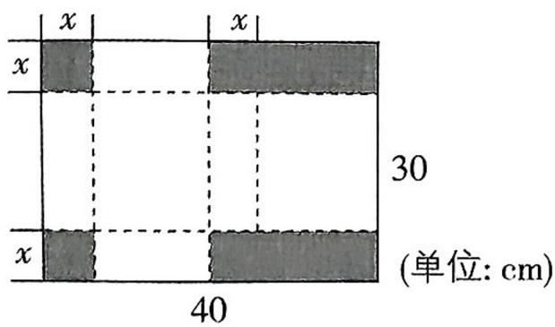

<!-- question-source:start -->
3 [2025 山东青岛校级质检]如图,把长 40 cm、宽 30 cm 的矩形纸板剪掉 2 个小正方形和 2 个小矩形(阴影部分即剪掉部分),将剩余的部分折成一个有盖的长方体盒子,设剪掉的小正方形的边长为 x cm(纸板的厚度忽略不计),若折成的长方体盒子的表面积是 950 cm²,则 x 的值是\_\_\_\_.

<!-- question-source:end -->

![[Q00107829A1]]
