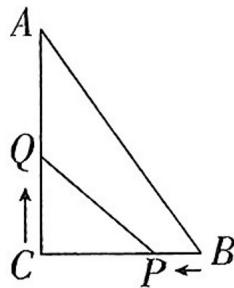

<!-- question-source:start -->
6 [2024 湖北武汉江岸区期中]如图, Rt△ACB 中, ∠C=90°, AC=7, BC=5, 点 P 从点 B 出发向终点 C 以 1 个单位长度每秒的速度移

动,点 Q 从点 C 出发向终点 A 以 2 个单位长度每秒的速度移动,P,Q 两点同时出发,一点先到达终点时 P,Q 两点同时停止移动,则当 $\triangle PCQ$ 的面积等于 4 时,经过的时间为 ( )
A.1 秒 B.2 秒 C.4 秒 D.1 秒或 4 秒
<!-- question-source:end -->

![[Q00107832A1]]
