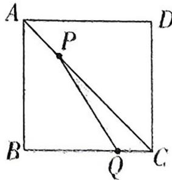

<!-- question-source:start -->
7 如图, 在正方形 $ABCD$ 中, $AB = 5 \mathrm{~cm}$ , 动点 $P$ 以 $\sqrt{2} \mathrm{~cm} / \mathrm{s}$ 的速度从点 $A$ 出发, 沿 $AC$ 向点 $C$ 移动, 同时动点 $Q$ 以 $1 \mathrm{~cm} / \mathrm{s}$ 的速度从点 $C$ 出发, 沿 $CB$ 向点 $B$ 移动, 设 $P, Q$ 两点移动时间为 $t \mathrm{~s}$ (0 < t < 5). 在 $P, Q$ 两点移动的过程中, $PQ$ 的长度能否等于 $\sqrt{10} \mathrm{~cm}$ ? 若能, 求出此时 $t$ 的值; 若不能, 请说明理由.

<!-- question-source:end -->

![[Q00107833A1]]
