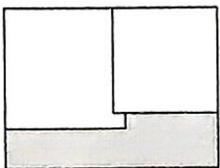
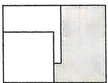
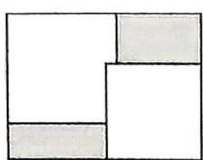

<!-- question-source:start -->
1 [2024 湖北随州调研, 中]一张矩形纸片上放置两张边长分别为 3 cm 和 4 cm 的小正方形纸片. 按照图(1)放置时, 矩形纸片没有被两张正方形纸片覆盖的部分 (阴影部分) 的面积为 8 cm $^{2}$ ; 按照图(2)放置时, 矩形纸片没有被两张正方形纸片覆盖的部分的面积为 11 cm $^{2}$ , 若把两张正方形纸片按图(3)放置, 则矩形纸片没有被两张正方形纸片覆盖的部分的面积为 ( )

图(1)

图(2)

图(3)

A. $5 \mathrm{~cm}^{2}$ B. $6 \mathrm{~cm}^{2}$ C. $7 \mathrm{~cm}^{2}$ D. $8 \mathrm{~cm}^{2}$
<!-- question-source:end -->

![[Q00107834A1]]
