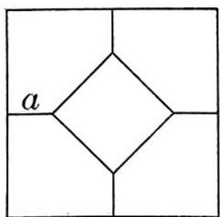

<!-- question-source:start -->
2 新考法 [2025 山东青岛期末, 中] 如图, 一块正方形地砖的图案是由 4 个全等的五边形和 1 个小正方形组成的, 已知小正方形的面积和五边形的面积相等, 并且图中线段 $a$ 的长度为 $\sqrt{10}-2$ , 则这块地砖的面积为 ( )

A. 50 B. 40 C. 30 D. 20
<!-- question-source:end -->

![[Q00107835A1]]
