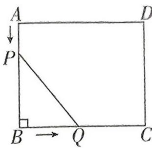

<!-- question-source:start -->
4[2024 广东河源期中, 中]如图, 在长方形 $ABCD$ 中, $AB = 5 \mathrm{~cm}, BC = 6 \mathrm{~cm}$ , 点 $P$ 从点 $A$ 开始沿边 $AB$ 向终点 $B$ 以 $1 \mathrm{~cm} / \mathrm{s}$ 的速度运动, 与此同时, 点 $Q$ 从点 $B$ 开始沿边 $BC$ 向终点 $C$ 以 $2 \mathrm{~cm} / \mathrm{s}$ 的速度运动. 如果 $P, Q$ 分别从 $A, B$ 同时出发, 当点 Q 运动到点 C 时, 两点同时停止运动. 设运动时间为 t s.

(1) 当 t 为何值时, PQ 的长度等于 5 cm?

(2)是否存在 t 的值,使得五边形 APQCD 的面积等于 $26 \, cm^{2}$ ? 若存在,请求出此时 t 的值;若不存在,请说明理由.

<!-- question-source:end -->

![[Q00107837A1]]
