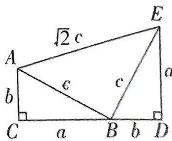

<!-- question-source:start -->
5 核心素养 几何直观 [2024 安徽淮北质检, 较难] 如图, 四边形 $ACDE$ 是证明勾股定理时用到的一个图形, $a, b, c$ 是 Rt $\triangle ABC$ 和 Rt $\triangle BED$ 的边长, 易知 $AE = \sqrt{2}c$ , 这时我们把关于 $x$ 的形如 $ax^2 + \sqrt{2}cx + b = 0$ 的一元二次方程称为“勾系一元二次方程”。
请解决下列问题: (1) 写出一个“勾系一元二次方程”;
(2) 求证: 关于 $x$ 的“勾系一元二次方程” $ax^2 + \sqrt{2}cx + b = 0$ 必有实数根;
(3) 若 $x = -1$ 是“勾系一元二次方程” $ax^2 + \sqrt{2}cx + b = 0$ 的一个根, 且四边形 $ACDE$ 的周长是 $6\sqrt{2}$ , 求 $\triangle ABC$ 的面积.

<!-- question-source:end -->

![[Q00107838A1]]
