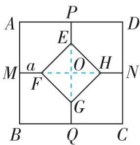

> [!success]- 必刷题
>
> > [!success] **【答案】** B
>
> > [!note]- **【解析】**
> > 如图, 连接小正方形的两条对角线, 设 FH 与 EG 交于点 O. 根据题意易知, 点 O 为正方形 ABCD,
> >
> > 
> >
> > EFGH 的中心, $\therefore S_{\triangle EOF} = \frac{1}{4} S_{\text{正方形} EFGH}$ , 即 $S_{\text{正方形} EFGH} = 4S_{\triangle EOF}$ . $\because S_{\text{五边形} AMFEP} = S_{\text{正方形} EFGH}$ , $\therefore S_{\text{五边形} AMFEP} = 4S_{\triangle EOF}$ . $\because S_{\text{五边形} AMFEP} = \frac{1}{4} S_{\text{正方形} ABCD} - S_{\triangle EOF}$ , $\therefore \frac{1}{4} S_{\text{正方形} ABCD} = 5S_{\triangle EOF}$ . 设正方形 $ABCD$ 的边长为 $2x$ , 则 $OF = OE = x - a$ , $\therefore \frac{1}{4} \cdot 2x \cdot 2x = 5 \times \frac{1}{2}(x - a)^2$ , 解得 $x = \frac{(5 \pm \sqrt{10})a}{3}$ . $\because a = \sqrt{10} - 2$ , $\therefore x = \sqrt{10}$ 或 $\frac{7\sqrt{10} - 20}{3}$ . $\because \frac{7\sqrt{10} - 20}{3} < a = \sqrt{10} - 2$ , $\therefore x = \sqrt{10}$ , $\therefore S_{\text{正方形} ABCD} = 2\sqrt{10} \times 2\sqrt{10} = 40$ . 故选 B.
> >
> > 刷有所得
> > 当销售问题中出现“要使顾客尽量得到实惠”或“最大限度减少库存”等实际要求时,要根据要求对所求得的解进行取舍.
