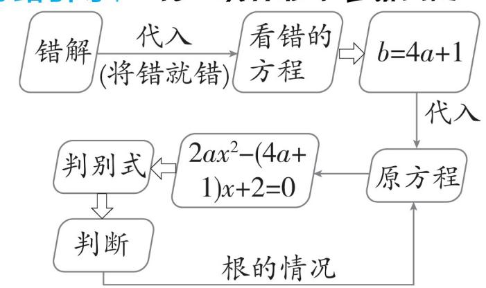

> [!success]- 必刷题
>
> > [!success] **【答案】** B
>
> > [!note]- **【解析】**
> > 
> > 【解析】把 x = -2 代入 $2ax^{2} + bx + 2 = 0$ 得 8a - 2b + 2 = 0, ∴ b = 4a + 1. 把 b = 4a + 1 代入方程 $2ax^{2} - bx + 2 = 0$ 得 $2ax^{2} - (4a + 1)x + 2 = 0$ .
> >
> > ∵ $(4a + 1)^{2} - 4 \times 2a \times 2 = (4a - 1)^{2} \geqslant 0$ , ∴ 方程 $2ax^{2} - bx + 2 = 0 (a \neq 0)$ 有两个实数根.
> >
> > 故选 **B**.
