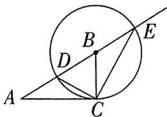

<!-- question-source:start -->
2 考法[2024 江苏泰州姜堰区期中, 中]欧几里得的《几何原本》中记载了形如 $x^{2}-2bx+4c^{2}=0(b>2c>0)$ 的方程的图形解法: 如图, 画 Rt△ABC, 使 $\angle ACB=90^{\circ}, AC=2c, AB=b$ , 以 B 为圆心, BC 长为半径画圆, 交射线 AB 于点 D, E, 则该方程较大的根是 ( )

A. $CE$ 的长度 B. $CD$ 的长度 C. $DE$ 的长度 D. $AE$ 的长度
<!-- question-source:end -->

![[Q00107775A1]]
