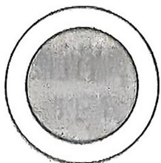

<!-- question-source:start -->
5[2025 广东广州期中]如图,把小圆形场地的半径增加 5 m 得到大圆形场地,场地面积扩大了一倍. 若设小圆形场地的半径为 x m,那么列方程正确的是 ( )

你购还怪好的啦

A. $2\pi x = \pi (x + 5)$ B. $x = 2(x + 5)$ C. $2\pi x^{2} = \pi (x + 5)^{2}$ D. $x^{2} = 2(x + 5)^{2}$ 建议用时-15分钟 普率 D25
<!-- question-source:end -->

![[Q00107399A1]]
