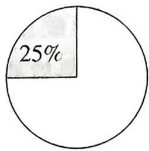
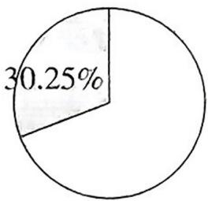

<!-- question-source:start -->
5 新考法[2025 山西吕梁质检]山西平遥有一句民谣:“平遥三件宝,熟肉、碗脱儿、案案糕”.为开拓全国市场,某案案糕生产厂家采用线下线上两种销售方式销售产品,店长统计了今年6月份和8月份线上销售量占总量的比例,根据比例绘制成如图所示的两幅扇形统计图,由统计图可知,线上销售量占比的月平均增长率为\_\_\_\_.

6月份

8月份
<!-- question-source:end -->

![[Q00107843A1]]
