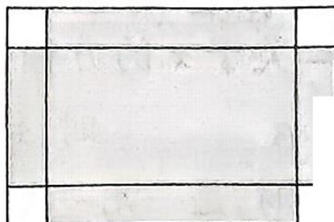

<!-- question-source:start -->
6 cm 的矩形纸板, 将纸板四个角各剪去一个同样大小的正方形, 可制成一个底面积是 $12 \, cm^{2}$ 的无盖长方

体纸盒. 小华设剪去的正方形边长为 $x \mathrm{~cm}$ , 列出关于 $x$ 的方程 $(8 - 2x)(6 - 2x) = 12$ , 整理得 $x^{2} 7x + 9 = 0$ .

他想知道剪去的正方形边长到底是多少, 下而是他的探索过程.

第一步：

<table><tr><td>x</td><td>-1</td><td>0</td><td>1</td><td>2</td></tr><tr><td> $x^{2}-7x+9$ </td><td>17</td><td>9</td><td></td><td></td></tr></table>

因此，\_\_\_\_ <x< \_\_\_\_.

第二步：

<table><tr><td>x</td><td>1.5</td><td>1.6</td><td>1.7</td><td>1.8</td></tr><tr><td> $x^{2}-7x+9$ </td><td>0.75</td><td>0.36</td><td>-0.01</td><td>-0.36</td></tr></table>

因此，\_\_\_\_ <x< \_\_\_\_.

(1)请你帮助小华完成表格中未完成的部分,并写出 $x$ 的范围;

(2)通过以上探索,请直接估计出x的值.(结果保留一位小数)

电子错题本鸭
<!-- question-source:end -->

![[Q00107409A1]]
