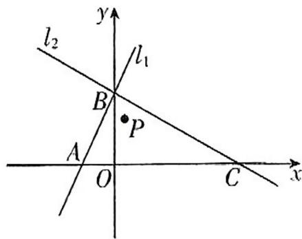

<!-- question-source:start -->
3[2025 河北石家庄调研, 中]如图, 点 $P(a, a+2)$ 是平面直角坐标系 $xOy$ 中的一个动点, 直线 $l_{1}$ 与 $x$ 轴, $y$ 轴分别交于点 $A\left(-\frac{5}{2}, 0\right), B(0,5)$ , 直线 $l_{2}$ 经过点 $B$ 和点 (6,2) 并与 $x$ 轴交于点 $C$ . (1) 求直线 $l_{1}$ 和 $l_{2}$ 的表达式及点 $C$ 的坐标. (2) 当点 $P$ 在 $\triangle ABC$ 的内部 (包含边界) 时, ①求 $a$ 的取值范围; ②是否存在点 $P$ , 使得 $\angle OPA = 90^{\circ}$ ? 若存在, 直接写出点 $P$ 的坐标; 若不存在, 请说明理由.

电子错题本鸭
<!-- question-source:end -->

![[Q00107442A1]]
