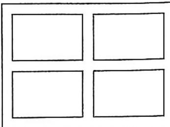

<!-- question-source:start -->
1 [2025 河南洛阳期末, 中] 如图, 某项绿化工程中有一块长为 60 米, 宽为 40 米的矩形空地, 计划在其中修建四块相同的矩形绿地, 四块绿地之间及周边都留有人行通道.

(1) 原计划要求四块相同的矩形绿地面积之和为 1836 平方米, 且四块绿地之间及周边留有宽度相等的人行通道, 则人行通道的宽度是多少米? (参考数据: $\sqrt{7744} = 88$ )

(2) 实际绿化时修改方案为①保证横向人行通道与原计划设计的宽度一样; ②四块相同的矩形绿地的长、宽之比与整个空地的长、宽之比相等; ③三条纵向人行通道宽度相等. 请你设计一种纵向人行通道的宽度, 使之恰能满足上述方案.

<!-- question-source:end -->

![[Q00107795A1]]
