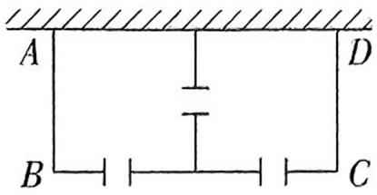
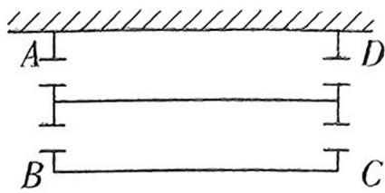

## 课时 2 用公式法求解一元二次方程的应用 刷提升

## 刷提升

![[初中/课堂同步/教辅/必刷题/2026《初中必刷题》数学北师9上/02_第二章_一元二次方程/课时_2_用公式法求解一元二次方程的应用/questions/Q00107795.md]]
![[初中/课堂同步/教辅/必刷题/2026《初中必刷题》数学北师9上/02_第二章_一元二次方程/课时_2_用公式法求解一元二次方程的应用/questions/Q00107796.md]]

## 建议用时 25 分钟 答案 D31

(2)方案2中矩形ABCD的面积能为 $54 \mathrm{~m}^{2}$ 吗? 若能, 请求出 $AB$ 的长; 若不能, 说明理由.

图(1)

图(2)

![[初中/课堂同步/教辅/必刷题/2026《初中必刷题》数学北师9上/02_第二章_一元二次方程/课时_2_用公式法求解一元二次方程的应用/questions/Q00107442.md]]

## 刷基础
