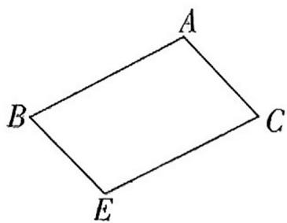
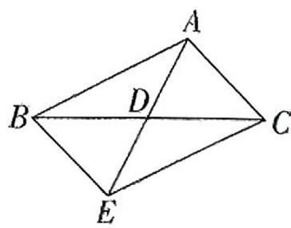

<!-- question-source:start -->
7 核心素养 几何直观 [2025 黑龙江哈尔滨校级期中, 中] 如图(1), 四边形 $ABEC$ 中, $AB$ 平行于 $CE$ , $\angle B = \angle C$ .

(1) 求证: $AB = CE$ ;

(2)如图(2),连接AE,BC交于点D,若四边形ABEC的面积为60,求△ADC的面积;

(3) 在 (2) 的条件下, $\angle BAC + \angle DAC = 180^{\circ}$ , $AD = 5$ , 求 $AC$ 的长.

图(1)

图(2)

电子错题本鸭
<!-- question-source:end -->

![[Q00107436A1]]
