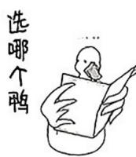

<!-- question-source:start -->
1 [2025 河北邯郸调研, 中]对于两个不相等的实数 $a, b$ , 我们规定符号 $\max \{a, b\}$ 表示 $a, b$ 中的较大值, 如: $\max \{1, 3\} = 3$ , $\max \{-1, -3\} = -1$ . 按照这个规定, 若 $\max \{x, -x\} = \frac{x^2 - 2x - 1}{2}$ , 求 $x$ 的值. 甲答: $x = \sqrt{5} + 2$ 或 $x = -1$ ; 乙答: $x = 2 - \sqrt{5}$ ; 丙答: $x = 1$ , 则正确的是 ( )

A. 只有甲的答案对

B. 甲、乙答案合在一起才完整

C. 甲、丙答案合在一起才完整

D. 三人答案合在一起才完整

<!-- question-source:end -->

![[Q00107777A1]]
