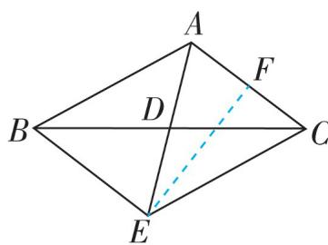

> [!success]- 必刷题
>
> > [!success] **【答案】** (1)
>
> > [!note]- **【解析】**
> > 【证明】∵ $AB \parallel CE, \therefore \angle B + \angle E = 180^{\circ}$ .
> >
> > ∵ $\angle B = \angle C, \therefore \angle C + \angle E = 180^{\circ}, \therefore BE \parallel AC,$ ∴ 四边形 ABEC 是平行四边形, ∴ AB = CE.
> >
> > 【解】(2)由(1)可知, 四边形 ABEC 是平行四边形, ∴ $S_{\triangle ABC} = S_{\triangle BEC}, D$ 是 BC 的中点. ∵ 四边形 ABEC 的面积为 60, ∴ $S_{\triangle ABC} = \frac{1}{2} S_{四边形ABEC} = 30$ . ∵ D 是 BC 的中点, ∴ $S_{\triangle ADC} = S_{\triangle ADB} = \frac{1}{2} S_{\triangle ABC} = 15$ .
> >
> > 刷有所得
> > 用公式法解一元二次方程的一般步骤：
> > - **①**：把方程化成一般形式，进而确定 a, b, c 的值（注意符号）；
> > - **②**：求出 $b^{2}-4ac$ 的值（若 $b^{2}-4ac<0$ ，则方程无实数根）；
> > - **③**：在 $b^{2}-4ac \geqslant 0$ 的前提下，把 a, b, c 的值代入公式进行计算，求出方程的根.
> >
> > (3)∵ 四边形 ABEC 是平行四边形, ∴ AE = 2AD = 10. ∵ AB // CE,
> > ∴ $\angle BAC + \angle ACE = 180^{\circ}$ . ∵ $\angle BAC +$
> >
> > 
> >
> > $\angle DAC = 180^{\circ}, \therefore \angle ACE = \angle DAC, \therefore AE = CE = 10.$ 如图，过点 $E$ 作 $EF \perp AC$ ，交 $AC$ 于点 $F$ ， $\therefore AF = CF = \frac{1}{2} AC.$ 设 $CF = x$ ，则 $AC = 2x.$ 在 Rt $\triangle CFE$ 中， $EF = \sqrt{CE^2 - CF^2} = \sqrt{100 - x^2}$ . $\because S_{\square ABEC} = AC \cdot EF = 60, \therefore 2x \cdot \sqrt{100 - x^2} = 60,$ $\therefore 4x^2(100 - x^2) = 3600$ ，令 $x^2 = a$ ，则 $4a(100 - a) = 3600$ ，即 $4a^2 - 400a = -3600$ ，配方，得 $4a^2 - 400a + 10000 = -3600 + 10000$ ，即 $(2a - 100)^2 = 6400$ ，开方，得 $2a - 100 = \pm 80$ ，解得 $a = 10$ 或 $a = 90.$ 当 $a = 10$ 时， $x^2 = 10$ ，解得 $x = \sqrt{10}$ 或 $x = -\sqrt{10}$ （舍去）， $\therefore AC = 2x = 2\sqrt{10}$ . 当 $a = 90$ 时， $x^2 = 90$ ，解得 $x = 3\sqrt{10}$ 或 $x = -3\sqrt{10}$ （舍去）， $\therefore AC = 2x = 6\sqrt{10}$ . 综上可知， $AC$ 的长为 $2\sqrt{10}$ 或 $6\sqrt{10}$ .
> >
> > ## 3 用公式法求解一元二次方程课时1 用公式法求解一元二次方程
> >
> > 刷有所得 $\Delta>0\Leftrightarrow$ 方程有两个不相等的实数根； $\Delta=0\Leftrightarrow$ 方程有两个相等的实数根； $\Delta<0\Leftrightarrow$ 方程没有实数根.
