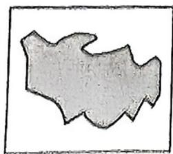
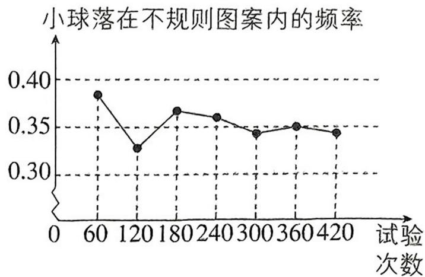

<!-- question-source:start -->
3 [中]如图(1)所示,平整的地面上有一个不规则图案(图中阴影部分),小明想了解该图案的面积是多少,他采取了以下办法:用一个长为5m,宽为4m的长方形,将不规则图案围起来,然后在适当位置随机地朝长方形区域扔小球,并记录小球落在不规则图案上的次数(球扔在边界线上或长方形区域外不计试验结果),他将若干次有效试验的结果绘制成了图(2)所示的折线统计图,由此他估计不规则图案的面积大约为 $m^{2}$ (结果取整数).

图(1)

图(2)
<!-- question-source:end -->

![[Q00108278A1]]
