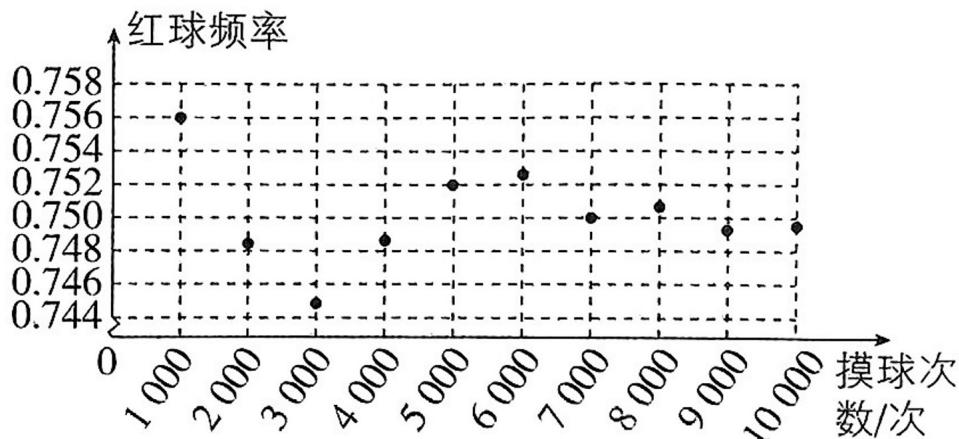

<!-- question-source:start -->
4 [2025 北京海淀区校级质检,较难]在学习“用频率估计概率”这一节时,小明和他的伙伴们设计了一个摸球试验:在一个不透明帆布袋中装有白球和红球共4个,这4个球除颜色外无其他差别,每次摸球前先将袋中的球搅匀,然后从袋中随机摸出1个球,观察该球的颜色并记录,再把它放回,在老师的帮助下,小明和他的伙伴们用计算机模拟这个摸球试验,如图是这个试验中摸出一个球是红球的结果.

(1)根据所学的频率与概率关系的知识,估计从这个不透明的帆布袋中随机摸出一个球是红球的概率是\_\_\_\_,其中红球的个数是\_\_\_\_;

(2)如果从这个不透明的帆布袋中同时摸出两个球,用列表法求摸出的两个球刚好是一个红球和一个白球的概率;

(3)在这个不透明的帆布袋中再放入 $n$ 个白球, 那么(2)中所求的概率将变为\_\_\_\_(用 $n$ 表示).

是个新“烤”鸭

电子错题本鸭
<!-- question-source:end -->

![[Q00108279A1]]
