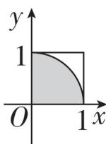

> [!success]- 必刷题
>
> > [!success] **【答案】** B
>
> > [!note]- **【解析】**
> > 观察题表可得种子发芽的概率估计值为 0.95. 设需要的试验种子个数为 $x$ . 根据题意, 得 $95 \% x = 2500$ , 解得 $x \approx 2632$ . $\therefore$ 要使发芽种子个数至少为 2500, 与至少需要的试验种子个数最接近的数为 2700, 故选 B. ----▶ 刷有所得
> >
> > $$
> > \frac {4 n}{m}
> > $$
> >
> > ## 思路分析
> >
> > $$
> > \begin{array}{l} 0 \leqslant x \leqslant 1 \\ 0 \leqslant y \leqslant 1 \end{array}
> > $$
> >
> > 
> >
> > 【解析】根据题意可知,有 n 个有序数对 $(x,y)$ 对应的点落在上图中的阴影部分,∴ 每个点落在阴影部分的频率为 $\frac{n}{m}$ , 每个点落在阴影部分的概率为 $\frac{\frac{1}{4}\pi}{1}$ . ∵ 当试验次数足够多时,
> >
> > 可用频率估计概率, ∴ $\frac{\frac{1}{4}\pi}{1} \approx \frac{n}{m}$ , 解得 $\pi \approx \frac{4n}{m}$ . ∴ 可估计 $\pi$ 的值为 $\frac{4n}{m}$ .
> >
> > 频率是个试验值或使用时的统计值, 具有随机性, 可能取多个数值, 因此只能近似地反映事件发生可能性的大小; 概率是个理论值, 是由事件的本质所决定的, 只能取唯一值, 它能精确地反映事件发生可能性的大小.
