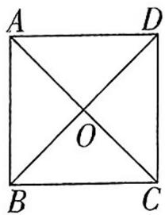
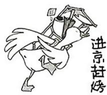

<!-- question-source:start -->
1 [2024 山东东营中考]如图,四边形 ABCD 是平行四边形,从①AC=BD,②AC⊥BD,③AB=BC,这三个条件中任意选取两个,能使□ABCD 是正方形的概率为 ( )

A. $\frac{2}{3}$ B. $\frac{1}{2}$ C. $\frac{1}{3}$ D. $\frac{5}{6}$
<!-- question-source:end -->

![[Q00107918A1]]
