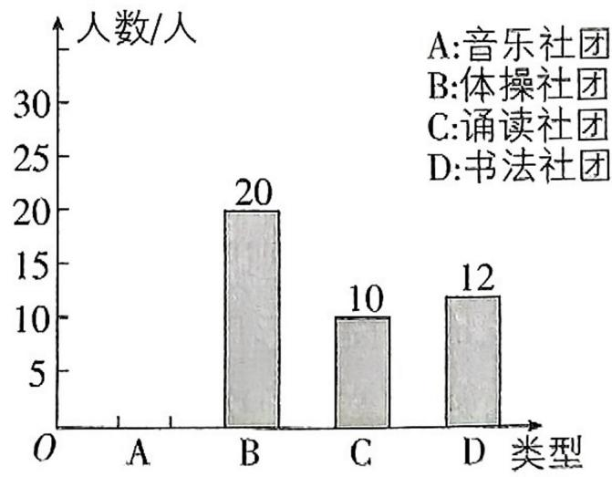
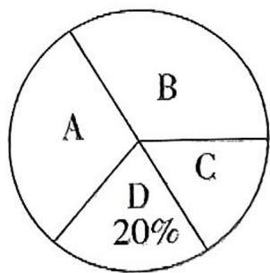

<!-- question-source:start -->
5 [2024 黑龙江绥化中考]为了落实国家“双减”政策,某中学在课后服务时间里,开展了音乐、体操、诵读、书法四项社团活动.为了了解七年级学生对社团活动的喜爱情况,该校从七年级全体学生中随机抽取了部分学生进行“你最喜欢哪一项社团活动”的问卷调查,每人必须选择一项社团活动(且只能选择一项).根据调查结果,绘制成如下两幅统计图.请根据统计图中的信息,解答下列问题:

(1)参加本次问卷调查的学生共有\_\_\_\_人;
(2)在扇形统计图中,A组所占的百分比是
\_\_\_\_,并补全条形统计图.

(3)端午节前夕,学校计划进行课后服务成果展示,准备从这4个社团中随机抽取2个社团汇报展示,请用树状图法或列表法,求选中的2个社团恰好是B和C的概率.

<!-- question-source:end -->

![[Q00107922A1]]
