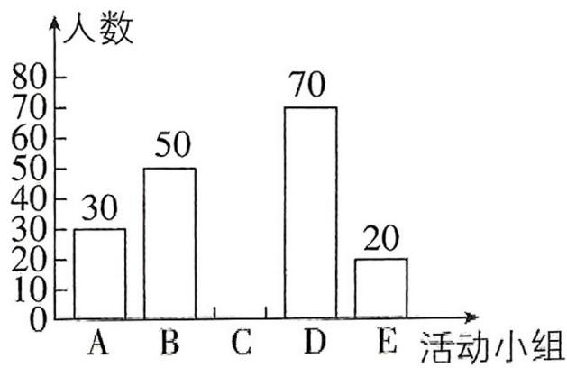
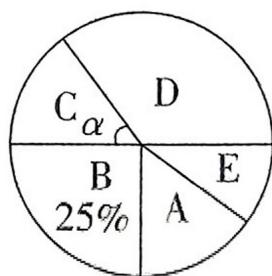

<!-- question-source:start -->
1 某校为落实“双减”工作,增强课后服务的吸引力,充分用好课后服务时间,为学有余力的学生拓展学习空间,成立了5个活动小组(每位学生只能参加一个活动小组):A. 音乐;B. 体育;C. 美术;D. 阅读;E. 人工智能. 为了解学生对以上活动的参与情况,随机抽取部分学生进行了调查统计,并根据统计结果,绘制了如图所示的两幅不完整的统计图.

<!-- question-source:end -->

![[Q00108280A1]]
