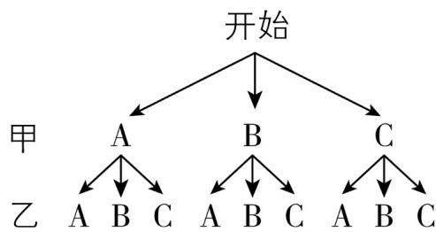

> [!success]- 必刷题
>
> > [!success] **【答案】** $\frac{1}{9}$
>
> > [!note]- **【解析】**
> > 画树状图如下：
> >
> > 
> >
> > 由树状图可知, 共有 9 种等可能的结果, 其中甲、乙两人同时选择景点 B 的结果有 1 种, ∴ 甲、乙两人同时选择景点 B 的概率为 $\frac{1}{9}$ . 故答案为 $\frac{1}{9}$ .
