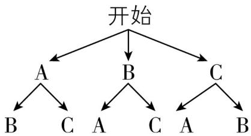

> [!success]- 必刷题
>
> > [!success] **【答案】** A
>
> > [!note]- **【解析】**
> > 【解】(1)∵3张相同的卡片上分别写有中国二十四节气中的“小满”“芒种”“夏至”的字样,∴洗匀后,从中任意抽取1张卡片,抽到写有“小满”的卡片的概率为 $\frac{1}{3}$ .故答案为 $\frac{1}{3}$ .
> > (2) 把写有中国二十四节气中的“小满”“芒种”
> >
> > 种”“夏至”的卡片分别记为 A、B、C，画树状图如下：
> >
> > 
> >
> > 共有6种等可能的结果,其中抽到一张写有“芒种”,一张写有“夏至”的卡片的结果有2种,∴抽到一张写有“芒种”,一张写有“夏至”的卡片的概率为 $\frac{2}{6}=\frac{1}{3}$ .
