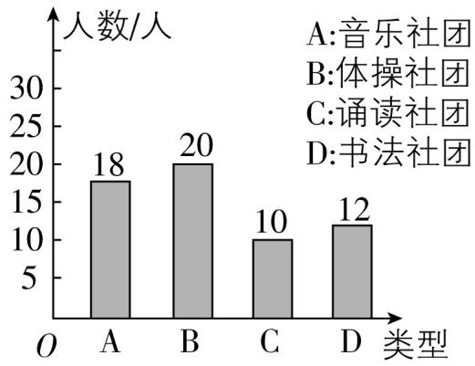

> [!success]- 必刷题
>
> > [!success] **【答案】** 60
>
> > [!note]- **【解析】**
> > 【解】(1)参加本次问卷调查的学生共有 $12 \div 20\% = 60$ (人). 故答案为 60.
> >
> > (2) A 组的人数为 $60 - 20 - 10 - 12 = 18$ (人), ∴ 在扇形统计图中, A 组所占的百分比是 $18 \div 60 \times 100\% = 30\%$ . 故答案为 $30\%$ .
> >
> > 补全条形统计图如图所示.
> >
> > ## 刷有所得
> >
> > 
> >
> > (3) 列表如下:
> >
> > 画树状图法可以不重复不遗漏地列出所有可能的结果，适合两步或两步以上完成的事件.
> >
> > <table><tr><td></td><td>A</td><td>B</td><td>C</td><td>D</td></tr><tr><td>A</td><td></td><td>(A,B)</td><td>(A,C)</td><td>(A,D)</td></tr><tr><td>B</td><td>(B,A)</td><td></td><td>(B,C)</td><td>(B,D)</td></tr><tr><td>C</td><td>(C,A)</td><td>(C,B)</td><td></td><td>(C,D)</td></tr><tr><td>D</td><td>(D,A)</td><td>(D,B)</td><td>(D,C)</td><td></td></tr></table>
> >
> > 思路分析根据题意假设袋中红球个数分别为 1, 2, 3, 再分别求出 $P$ (摸出一红一黄) 和 $P$ (摸出两红) 的值, 即可得出结论.
> >
> > 共有 12 种等可能的结果, 其中选中的 2 个社团恰好是 B 和 C 的结果有 (B, C), (C, B), 共 2 种, ∴ 选中的 2 个社团恰好是 B 和 C 的概率为 $\frac{2}{12} = \frac{1}{6}$ .
