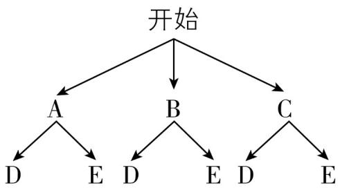

> [!success]- 必刷题
>
> > [!success] **【答案】** A
>
> > [!note]- **【解析】**
> > 画树状图如下：
> >
> > 
> >
> > 由树状图可知,共有6种等可能的结果,其中小张从 B 口进入, D 口离开的结果只有 1 种, ∴ 小张从 B 口进入, D 口离开的概率是 $\frac{1}{6}$ .
> >
> > 故选 **A**.
