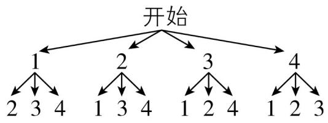

> [!success]- 必刷题
>
> > [!success] **【答案】** D
>
> > [!note]- **【解析】**
> > 画树状图如下：
> >
> > 
> >
> > 共有 12 种等可能的结果, 其中两个小球的标号之积为偶数的结果有 10 种, ∴ 乙获胜的概率为 $\frac{10}{12} = \frac{5}{6}$ .
> >
> > 故选 **D**.
