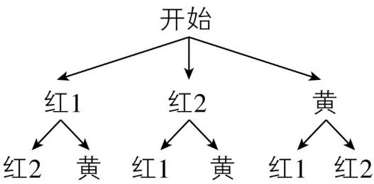
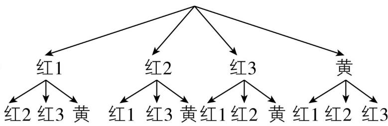

> [!success]- 必刷题
>
> > [!success] **【答案】** 15
>
> > [!note]- **【解析】**
> > 观察题中表格发现随着摸球试验次数的增多, 摸出白球的频率逐渐稳定在 0.6 附近, 故摸出白球的概率估计值为 0.6. 设白球有 $x$ 个, 则 $\frac{x}{x + 10} = 0.6$ , 解得 $x = 15$ , 经检验, $x = 15$ 是原方程的根, 且符合题意, 故答案为 15.
> >
> > 4.3 【解析】假设袋中红球个数为 1, 此时袋中有 1 个黄球、1 个红球, 搅匀后从中任意摸出两个球, $P(\text{摸出一红一黄}) = 1, P(\text{摸出两红}) = 0$ , 不符合题意. 假设袋中的红球个数为 2, 画树状图如下:
> >
> > 
> >
> > 由图可知,共有6种等可能的结果,其中摸到两个红球的结果有2种,摸出一红一黄的结果有4种,∴P(摸出一红一黄)= $\frac{4}{6}=\frac{2}{3}$ ,P(摸出两红)= $\frac{2}{6}=\frac{1}{3}$ ,不符合题意.假设袋中的红球个数为3,画树状图如下:
> >
> > 开始
> >
> > ## 第一个
> >
> > 
> >
> > 由图可知, 共有 12 种等可能的结果, 其中摸到两个红球的结果有 6 种, 摸出一红一黄的结果有 6 种, ∴ P(摸出一红一黄) = P(摸出两红) = $\frac{6}{12} = \frac{1}{2}$ , 符合题意, ∴ 放入的红球个数为 3, 故答案为 3.
