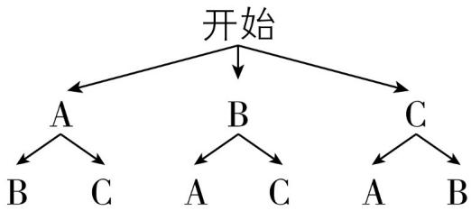

> [!success]- 必刷题
>
> > [!success] **【答案】** 详见解析
>
> > [!note]- **【解析】**
> > 【解】(1)假设硬币在 A 杯内,根据题意画树状图如下:
> >
> > 
> >
> > 共有6种等可能的情况,其中出现硬币的情况有4种,则出现硬币的概率是 $\frac{4}{6}=\frac{2}{3}$ .
> >
> > (2) 根据题意得, 第一次交换后的情况有 BAC, CBA, ACB; 把 BAC 再交换一次的情况有 ABC, CAB, BCA, 把 CBA 再交换一次的情况有 BCA, ABC, CAB, 把 ACB 再交换一次的情况有 CAB, BCA, ABC, 则共有 9 种等可能的情况, 硬币恰好在中间位置的杯子内的情况有 3 种, 则硬币恰好在中间位置的杯子内的概率为 $\frac{3}{9} = \frac{1}{3}$ .
