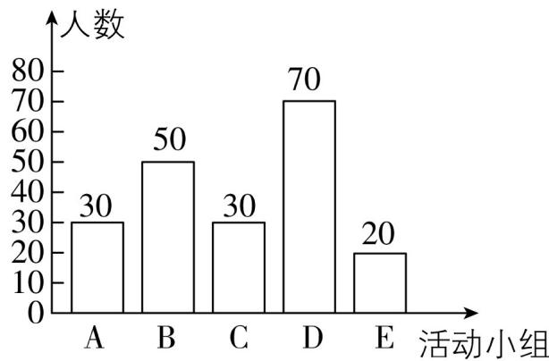
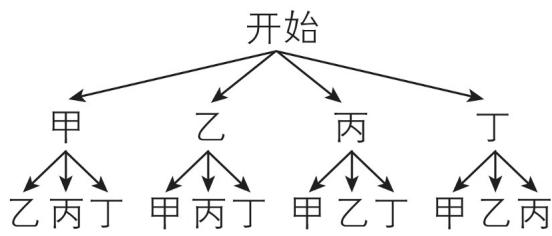

> [!success]- 必刷题
>
> > [!success] **【答案】** C
>
> > [!note]- **【解析】**
> > 【解】(1)①此次调查一共随机抽取的学生人数为 $50 \div 25\% = 200$ . 故答案为 200.
> > - **②**：C 组的人数为 200 - 30 - 50 - 70 - 20 = 30.
> > 补全条形统计图如下：
> >
> > (2) 先列举出经过两次交换后的所有等可能的情况数, 再找出硬币恰好在中间位置的杯子内的情况数, 最后根据概率公式计算即可.
> >
> > 
> > - **③**：扇形统计图中圆心角 $\alpha = 360^{\circ} \times \frac{30}{200} = 54^{\circ}$ , 故答案为 54. (2) $3200 \times \frac{70}{200} = 1120$ . 答: 估计该校参加 D 组(阅读)的学生人数为 1120. (3)画树状图如下:
> >
> > 
> >
> > 共有 12 种等可能的结果, 其中恰好抽中甲、乙两人的结果有 2 种,
> > ∴ 恰好抽中甲、乙两人的概率为 $\frac{2}{12}=\frac{1}{6}$ .
> >
> > ## 第四章 图形的相似
> >
> > ## 1 成比例线段
> >
> > ## 课时1 成比例线段及比例的基本性质
> >
> > ## 刷基础
> >
> > 1. C 【解析】A、B、D 选项中的两图形形状不同, 不符合题意; C 选项中的两图形形状相同, 符合题意. 故选 C.
> >
> > 2. B 【解析】设 A 地到 B 地的实际距离为 $x \mathrm{~cm}$ . 根据题意得 $1: 5500000 = 6: x$ , 解得 $x = 33000000, \therefore$ A 地到 B 地的实际距离为 $33000000 \mathrm{~cm} = 330 \mathrm{~km}$ . 故选 B.
> >
> > 3. B 【解析】设三角形的三个内角分别是 k, 2k, 3k, 则 $k + 2k + 3k = 180^{\circ}$ , 解得 $k = 30^{\circ}$ , ∴ 这个三角形的三个内角分别是 $30^{\circ}$ , $60^{\circ}$ , $90^{\circ}$ , ∴ 它的最长边与最短边之比为 2:1. 故选 B.
> >
> > 4. D 【解析】设 AB = 5x，则 BC = 12x，∴ AC = AB + BC = 5x + 12x = 17x，∴ AC : BC = 17x : 12x = 17 : 12。故选 D。
> >
> > 5. B 【解析】 $3 \times 15 = 5 \times 9$ ，故 A 选项中四条线段成比例，不符合题意； $1 \times 4 \neq 2 \times 3$ ，故 B 选项中
> >
> > 归纳总结
> > 比例尺 = 图上
> > 距离: 实际距离, 要注意单位需要一致.
> >
> > 四条线段不成比例,符合题意; $1\times12=3\times4$ ,故C选项中四条线段成比例,不符合题意; $10\times10=5\times20$ ,故D选项中四条线段成比例,不符合题意.故选B.
> >
> > 6.【解】这两个等腰三角形的腰与底边是成比例线段. 理由: ∵ 在等腰 $\triangle ABC$ 和等腰 $\triangle A_{1}B_{1}C_{1}$ 中, 底边的长 BC = 4 cm, $B_{1}C_{1} = 6$ cm, 它们的周长分别为 16 cm 和 24 cm, ∴ $AB = \frac{1}{2} \times (16 - 4) = 6$ (cm), $A_{1}B_{1} = \frac{1}{2} \times (24 - 6) = 9$ (cm).
> >
> > ∵ $\frac{AB}{A_{1}B_{1}} = \frac{6}{9} = \frac{2}{3}$ , $\frac{BC}{B_{1}C_{1}} = \frac{4}{6} = \frac{2}{3}$ , ∴ $\frac{AB}{A_{1}B_{1}} = \frac{BC}{B_{1}C_{1}}$ ,
> >
> > ∴ 这两个等腰三角形的腰与底边是成比例线段.
> >
> > 7. D 【解析】由比例的基本性质可知, 若 $\frac{x}{y} = \frac{4}{3}$ , 则 3x = 4y, 故 D 符合题意. 故选 D.
> >
> > 8. $\frac{3}{4}$ 【解析】根据题意得 $4x = 3y$ . $\because y \neq 0$ , $\therefore \frac{x}{y} = \frac{3}{4}$ . 故答案为 $\frac{3}{4}$ .
