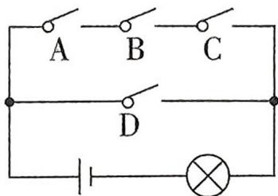

<!-- question-source:start -->
6 新考向 跨学科综合 [2024 陕西宝鸡渭滨区期末] 如图,电路图上有四个开关 A,B,C,D 和一个小灯泡,则任意闭合其中两个开关,小灯泡发光的概率是 ( )

不愧是我鸭

A. $\frac{1}{2}$ B. $\frac{1}{3}$ C. $\frac{1}{4}$ D. $\frac{1}{6}$
<!-- question-source:end -->

![[Q00107884A1]]
