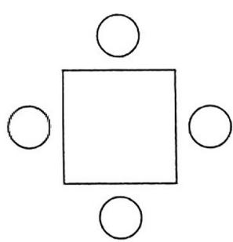
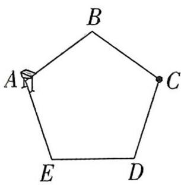

<!-- question-source:start -->
2 新考法[2025 湖北武汉调研, 中]如图, 公园里的方桌旁有 4 个圆凳, 甲、乙、丙、丁 4 人随机坐到这 4 个圆凳上, 则甲坐在乙对面的概率为 ( )
A. $\frac{1}{4}$ B. $\frac{1}{2}$ C. $\frac{1}{3}$ D. $\frac{2}{3}$

(第2题图)

(第4题图)
<!-- question-source:end -->

![[Q00107889A1]]
