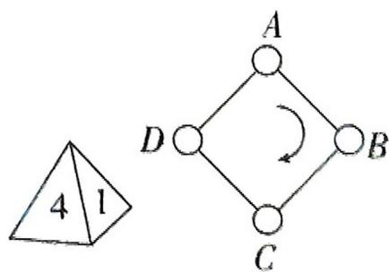
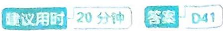

<!-- question-source:start -->
6 核心素养 数据观念 [较难] 如图(1), 一枚质地均匀的正四面体骰子, 它有四个面并分别标有数字 1,2,3,4. 如图(2), 正方形 $ABCD$ 顶点处各有一个圈. 跳圈游戏的规则为游戏者每掷一次骰子, 骰子着地一面上的数字是几, 就沿正方形的边按顺时针方向连续跳几个边长. 如: 若从圈 $A$ 起跳, 第一次掷得 3 , 就沿顺时针连续跳 3 个边长, 落到圈 $D$ ; 若第二次掷得 2 , 就从圈 $D$ 开始沿顺时针连续跳 2 个边长, 落到圈 $B$ ……设游戏者从圈 $A$ 起跳. (1) 嘉嘉随机掷一次骰子, 求落回到圈 $A$ 的概率 $P_{1}$ . (2) 淇淇随机掷两次骰子, 用列表法求最后落回到圈 $A$ 的概率 $P_{2}$ , 并指出按她的投掷方法落回到圈 $A$ 的可能性与嘉嘉是否一样.

图(1)
图(2)

<!-- question-source:end -->

![[Q00107893A1]]
