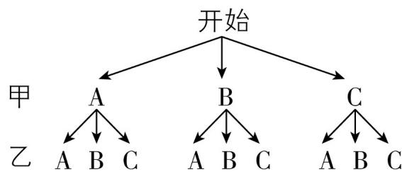

> [!success]- 必刷题
>
> > [!success] **【答案】** A
>
> > [!note]- **【解析】**
> > 把 3 节车厢分别记为 A, B, C, 画树状图如下:
> >
> > 
> >
> > 共有9种等可能的结果,其中甲和乙不是从同一节车厢上车的结果有AB,AC,BA,BC,CA,CB,共6种,∴甲和乙不是从同一节车厢上车的概率为 $\frac{6}{9}=\frac{2}{3}$ .
> >
> > 故选 **A**.
